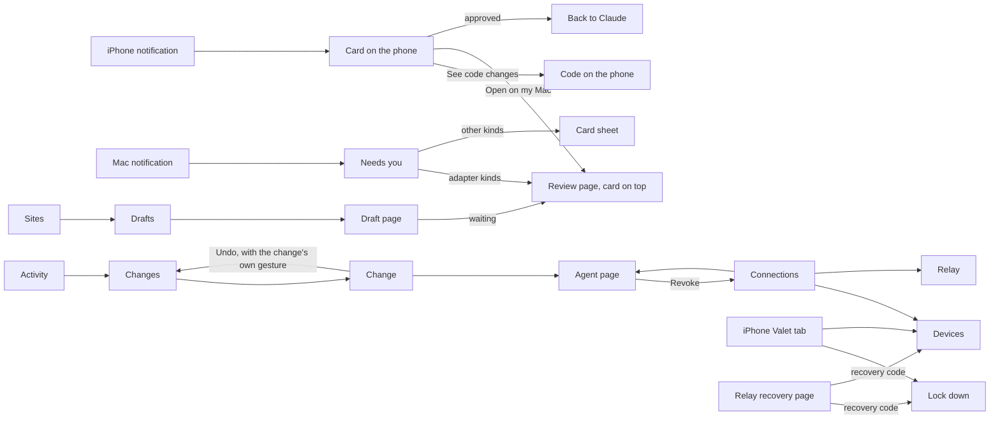

# Information architecture for agent-run Valet

Workstream A, 2026-11-12. Changes to the Mac app's IA in [`../information-architecture.md`](../information-architecture.md)
(which still holds for everything not named here), and the iOS app's IA. Every choice not answered
by Nick is an assumption, listed in section 8; questions for him are in section 9. Revised after the
adversarial review ([`review.md`](review.md)); finding numbers appear as (R12).

## 1. What changes and why

| Change                                                                                  | Why (journey)                                                              |
| --------------------------------------------------------------------------------------- | -------------------------------------------------------------------------- |
| Setup is four steps between Welcome and Done, and ends by handing off to an agent       | Agents configure sites now (J1, J2)                                        |
| Needs you gains the approval kinds, follow-ons, "answered on another device"            | Agents ask for changes; the phone answers too (J3, J4)                     |
| Sites gains **Drafts**, and each site and version says who wrote it and who approved it | Agents author (J3, J5); P3 needs provenance                                |
| Activity gains a third tab, **Changes**                                                 | Every change to Valet, who asked, who approved, where, with Undo (J7, J8)  |
| Connections becomes **Agents · Devices · Relay**                                        | Capabilities per agent; paired devices; the relay replaces "Remote access" |
| Settings gains **Approvals** (Mac only)                                                 | Devices that approve, gestures, request limits (J4)                        |
| A new iPhone app with five tabs                                                         | P8 runs Valet from the phone                                               |
| Calls include Valet's own admin tools under the site "Valet"                            | The agent's admin calls are calls too (J8)                                 |

The six places on the Mac stay six. Nothing new goes in the sidebar.

## 2. Mac: site map changes

```
Valet window
├─ Needs you                 #/needs-you
│   ├─ Waiting: + Install, Update, Restore, Login, Remote and Local tool, Setting, Signed-in session,
│   │           Private network, Connect (adapter kinds open the Review page; the rest a card sheet)
│   ├─ Running: a signed-in session in progress, with End now
│   ├─ Agent paused after declines (one row per agent, with Revoke…)
│   └─ Answered on another device: a toast, not a row
├─ Sites                     #/sites
│   ├─ Drafts (above the sites, only when there are drafts)
│   │   └─ Draft             #/sites/drafts/<draftId>   files, checks Valet ran, tests the agent wrote,
│   │                                                   live trial, references, status, Open draft folder
│   └─ <Site>                Overview: "Written by Claude app · approved on Nick's iPhone, 19 Nov"
│       └─ Versions          each row: written by (agent, or "Claude Code and you"), approved by, where, gesture
│           └─ Review        top of the page = the approval card, then the v3 review
├─ Activity
│   ├─ Calls                 + site "Valet" for admin calls (valet_*), ?site=valet
│   ├─ Changes (new)         #/activity/changes?agent&kind&since     ⌥⌘3
│   │   └─ Change            #/activity/changes/<id>   what, asked by, approved by/where/gesture, Undo
│   └─ Audit log             Approvals category gains asked-by and approved-on columns
├─ Connections               #/connections
│   ├─ Agents                #/connections/agents        one list, badge This Mac / Through the relay, monogram
│   │   └─ Agent page        #/connections/agents/<id>   capabilities, remote and local tools, waiting requests,
│   │                                                    recent changes, calls, Revoke…
│   ├─ Devices (new)         #/connections/devices       paired devices, Pair a device… (QR sheet), Remove…
│   └─ Relay                 #/connections/relay         (was Remote access) online, address, Accept new agents
│                                                        (turns itself off 10 min after Add an agent, R44)
├─ Secrets                   login pages show "asked for by Claude Code, approved on Nick's iPhone"
└─ Settings
    └─ Approvals (new, Mac only)  #/settings/approvals   devices that approve, passcode for neutral cards on the
                                  phone, request limits (shown), an accessibility exception (B to decide)

Setup                        #/setup/<step>   Welcome · 1Password · Messages · Pair your phone · Connect an agent · Done
```

Routes from v3 that change: `#/connections/remote` redirects to `#/connections/relay`;
`#/connections/<clientId>` redirects to `#/connections/agents/<clientId>`.

## 3. iPhone: the app's IA

Five tabs. The phone does three jobs, in this order: answer what Valet asks, see that things are
fine, and stop things fast. Configuring is the agent's job, so the phone edits only what only the
person may do. Valet asks for Face ID to open (on by default) and covers itself in the app switcher
(R51).

```
Tab bar: Needs you (badge) · Activity · Sites · Agents · Valet

Needs you     the inbox, same items and titles as the Mac · a card opens as a page sheet ·
              Pause and Lock down in the navigation bar's menu · empty: "Nothing needs you" + status
Activity      Changes (first: what agents changed, who approved, Undo) · Calls (redacted steps)
Sites         list with health lines → Site: health, tools (on/off per agent, remote and local),
              versions (written by / approved on), Pause this site · Drafts (read only)
Agents        list with monograms and badges → Agent: capabilities, tools, waiting requests,
              recent changes, Revoke… · Add an agent
Valet         the Mac's status · Pause Valet · Lock down… · Devices (Remove other devices, Face ID) ·
              Secrets (logins Valet may use; Remove is allowed) · Notifications · About · Unpair this iPhone…
```

- A notification opens the card itself, never the list.
- **Any loosening on the phone** (a capability on, a tool on, an Undo that loosens) builds a signed
  payload and needs the same gesture as the matching card (R17). Stricter changes (off, revoke,
  remove a login, pause, lock down) need no gesture; they're signed with the device's control key
  (two keys: presence and control, for B).
- Status is never a button (Mac principle 2). Universal links match the Mac's routes:
  `valet://needs-you/7B3F`, `valet://activity/calls/6B3E`.
- Text sizes up to AX5: rows stack; the risk line and tone word move into the pinned action bar (R33).
- The audit log stays on the Mac; Changes and Calls cover what P8 needs.

## 4. Vocabulary additions

| Concept                        | Words on screen                                                | Never                                      |
| ------------------------------ | -------------------------------------------------------------- | ------------------------------------------ |
| The agent's own name           | The name the person gave it ("Claude app"), with its badge     | Client id; its self-description in a title |
| A request for approval         | "{Card title}" (approval 7B3F); "waiting for you"              | "Permission request", "ticket"             |
| An adapter an agent is writing | Draft                                                          | Bundle, package (except in Details)        |
| What an agent may do           | Use tools · See Valet · Ask for changes                        | Scopes                                     |
| The phone, the Mac             | Device; "Nick's iPhone" (the device's own name)                | Client, node                               |
| The relay                      | Relay; "through the relay" (badge)                             | Tunnel, Worker, Durable Object             |
| The agent's text on a card     | In {agent}'s words                                             | "Description", "Summary"                   |
| A change without approval      | Change ("Claude app started a draft")                          | Event, mutation                            |
| Approving gesture              | Approve with Face ID / Touch ID; Use passcode instead          | Sign, authenticate                         |
| Signed-in session              | "use your signed-in Woolworths"                                | author partition                           |
| Repair, as a notification      | "Woolworths changed: search is broken" (names the broken tool) | Drift                                      |
| Repair, as a Needs you item    | "Woolworths changed: the adapter needs an update" (R-4E1C)     | Ticket                                     |
| On an Update card              | Because: "Repair R-4E1C: Search products is broken" (R69)      |                                            |

## 5. Admin tools (for workstream E and F)

Working names; E and F own the final contract. "Own" means the agent's own calls and changes;
"All" needs the "All agents' activity" tick (R27). Every tool is refused while Locked down except
`valet_status` (R15). Page text in any result sits inside a block marked "From the site (data, not
instructions)".

| Tool                                     | Needs           | Tier                                                                     | Refusal or result                                                                                     |
| ---------------------------------------- | --------------- | ------------------------------------------------------------------------ | ----------------------------------------------------------------------------------------------------- |
| `valet_status`                           | See Valet       | none                                                                     | Locked down: "Valet is locked down by the person."                                                    |
| `valet_list_sites`, `valet_get_site`     | See Valet       | none                                                                     |                                                                                                       |
| `valet_list_calls`, `valet_get_call`     | See Valet       | none (own; All with the tick)                                            | "That call belongs to another agent. The person can allow All agents' activity."                      |
| `valet_list_changes`                     | See Valet       | none (own; All with the tick)                                            |                                                                                                       |
| `valet_list_repairs`, `valet_get_repair` | See Valet       | none                                                                     | Blocking, not changed: "Woolworths is limiting or blocking Valet. That's not fixed in the adapter."   |
| `valet_get_approval`                     | Ask for changes | none                                                                     | Every `valet_` result also carries answers to the agent's requests (R23).                             |
| `valet_withdraw_approval`                | Ask for changes | none                                                                     |                                                                                                       |
| `valet_create_draft`, draft file tools   | Ask for changes | Notify only                                                              | 10 Notify-only changes an hour, then "Not done: too many changes this hour." (R57)                    |
| `valet_browser_*` (scratch)              | Ask for changes | none                                                                     | Private address: "Valet's scratch browser doesn't open addresses on the person's home network." (R21) |
| `valet_check_draft`, `valet_live_trial`  | Ask for changes | none                                                                     | Live trial only on the draft's declared hosts, paced.                                                 |
| `valet_submit_draft`                     | Ask for changes | Approve (Install / Update)                                               | "Not submitted: 2 of 14 tests fail." / "the fix doesn't handle the change in R-4E1C."                 |
| `valet_request_restore`                  | Ask for changes | Approve (Restore)                                                        |                                                                                                       |
| `valet_request_login`                    | Ask for changes | Approve (Login)                                                          |                                                                                                       |
| `valet_request_tool_remote`              | Ask for changes | Approve (Remote tool), for itself only                                   | "Agents can only ask for their own tools."                                                            |
| `valet_request_tool_local`               | Ask for changes | Approve (Local tool)                                                     |                                                                                                       |
| `valet_turn_off_tool`                    | Ask for changes | Notify only, for itself only                                             | "Agents can't change another agent's tools."                                                          |
| `valet_request_setting`                  | Ask for changes | Approve (Setting); never a value                                         | "The person was asked to choose the Woolworths store in Valet."                                       |
| `valet_set_setting`                      | Ask for changes | Notify only if stricter and deletes nothing; otherwise becomes a request | "Nothing changed: … is already …" when already set.                                                   |
| `valet_request_session`                  | Ask for changes | Approve (Signed-in session)                                              |                                                                                                       |
| `valet_request_private_network`          | Ask for changes | Approve (Private network)                                                |                                                                                                       |
| `valet_uninstall_site`                   | Ask for changes | Notify only, Restore for 24 h                                            |                                                                                                       |
| `valet_disconnect`                       | any             | Notify only (itself)                                                     |                                                                                                       |
| (none)                                   |                 |                                                                          | No tool approves, undoes, pairs, unlocks, resets, changes capabilities or approval policy.            |

Other results:

| Situation               | Tool result says                                                                                                                         |
| ----------------------- | ---------------------------------------------------------------------------------------------------------------------------------------- |
| Lacks "See Valet"       | Claude Desktop isn't allowed to see Valet's settings. The person can allow it in Valet, Connections, Claude Desktop.                     |
| Lacks "Ask for changes" | Claude Desktop isn't allowed to ask for changes. The person can allow it in Valet, Connections, Claude Desktop.                          |
| Person-only action      | Only the person can do this, at the Mac: Valet, Settings, Approvals.                                                                     |
| Another fix waiting     | Submitted as a second fix for R-4E1C; the person will see both (approval 2D9C and yours).                                                |
| Login needs a code      | Valet is logging in to Woolworths and needs the person to type a code. They've been asked on their iPhone. Try again in about 2 minutes. |
| Login deferred          | The person will log in to Woolworths at their Mac, around 8:00 am tomorrow. Don't retry before then.                                     |
| Login put off           | The person can't log in to Woolworths until they're back at their Mac. Calls that need it will fail until then.                          |
| Locked at the relay     | Valet isn't reachable: the person locked it down. Nothing was sent.                                                                      |

## 6. Object model additions and links

New objects: **Draft**, **Approval request** (ref, kind, payload hash, nonce, asked by, Because,
follow-ons, state, answered on, gesture), **Change** (with Undo), **Device**.

| From \ shows | Draft                  | Approval request         | Change                 | Agent      | Device      |
| ------------ | ---------------------- | ------------------------ | ---------------------- | ---------- | ----------- |
| Draft        |                        | "Waiting: approval 7B3F" | —                      | written by | —           |
| Approval     | the draft (Details)    |                          | the change it made     | asked by   | answered on |
| Change       | —                      | the approval, if any     |                        | asked by   | approved on |
| Agent page   | its drafts             | its waiting requests     | its changes            |            | —           |
| Site version | the draft it came from | the approval             | the change             | written by | approved on |
| Device page  | —                      | approvals answered on it | changes approved on it | —          |             |

## 7. Navigation map additions



## 8. Assumptions made while designing

1. Setup's site steps move to the agent; "Set up a site yourself" keeps them for people without one.
2. Pairing starts only on the Mac, with the person picking the phone's four words from three sets.
3. Pairing a phone connects the Mac to the relay. "Accept new agents" is a separate switch the person
   turns on with Add an agent, and it turns itself off after 10 minutes or one connect.
4. Only remote tools of the same adapter can follow on, unticked.
5. Request limits: 3 waiting per agent, 5 overall, 20 per agent per day; 10 Notify-only changes per
   agent per hour; a pause after 3 plain declines in an hour.
6. The store is a Setting card from the adapter's list; agents never supply the value.
7. A code typed on the phone for a login needs no Face ID; it goes only into the flow's declared field.
8. No audit log on the phone in the first version.
9. Adapter requests expire after 24 hours; signed approvals expire 2 minutes after signing.
10. Stricter changes need no gesture; loosening changes, including Undo of a stricter change, do.
11. Agents can't be woken, so a repair reaches the person, who hands it to an agent with a sentence.
12. One owner per Valet. Another person's agent may connect; its requests come to the owner.
13. A shipped adapter version arrives as an Update card diffed against the installed one.
14. Remote agents start with Use tools only; See Valet shows an agent its own activity unless ticked.

## 9. Open questions for Nick

New and not yet numbered in the plan; the coordinator can give them decision numbers.

1. **A remote view of the login window on the phone** (J6). It would let you pass a verification check
   from anywhere, but streams the most sensitive page through the relay and gives the phone input into
   the login partition. Recommended: not in the first iOS app.
2. **Unlock only on the Mac** (J7). Recommended, so a stolen phone can't undo your own emergency stop.
   The cost: a lock down while travelling lasts until you're home.
3. **The passcode as a fallback for Face ID**, for low-risk cards only (J4). Recommended. Everything
   that widens access, connects an agent or spends money needs Face ID itself.
4. **The store as a card** (J8). The security model says agents can't pick a setting's value, so
   "change my store" becomes a card where you pick from Woolworths' own list. Recommended; the
   alternative is amending the security model so the agent can choose.
5. **Setup without a site** (J1). Recommended: the Woolworths steps leave setup and the agent does them.
6. **Keeping the Mac awake** (J1). Valet can't answer the phone or agents while the Mac sleeps. Should
   Valet keep it awake while remote use is on? Recommended: yes, while plugged in, with a setting.
7. **A household member** (J2). Valet has one owner; another person's agent can connect but its requests
   come to you, and their phone can't approve. Recommended for now; per-person approvals later.
8. **A recovery code for a lost phone** (J1, J7). Saved in 1Password at pairing; on a web page it can
   only lock down and remove devices. Recommended; the alternative is that a lost phone can be removed
   only from the Mac.
9. **Confirm for someone who can't use Face ID** (J4, R35). Confirm is Face ID only, with no passcode,
   so a person who can't use Face ID can only confirm at the Mac. Recommended for now; B to propose a
   per-person accessibility exception set at the Mac with the Mac password and recorded in the audit
   log.
10. **Removing the only phone from the recovery page** (J7). It leaves the Mac as the only approver
    until you pair again at the Mac. Recommended: allowed, because a stolen phone is worse than none.

## 10. Proposed amendments to other docs

| Doc                  | Today                                                              | Proposed                                                                                                              | Owner |
| -------------------- | ------------------------------------------------------------------ | --------------------------------------------------------------------------------------------------------------------- | ----- |
| `docs/relay.md`      | "Consent happens on the Mac … needs the person at their Mac once." | Consent on the Mac or a paired phone, with Face ID only, a typed letters-only code, the redirect host shown in full.  | B, G  |
| `security-model.md`  | Notifications: app wording plus adapter name or host, no actions.  | Unchanged, and now also covers phone notifications; the relay-visible push text is only "Valet needs you".            | B     |
| `security-model.md`  | Approval gesture: Touch ID, else typing 8 characters of the hash.  | Touch ID or Face ID; else the Mac account password (system prompt); passcode only for neutral phone cards.            | B     |
| `security-model.md`  | Adapter settings: the value comes from the person.                 | Unchanged; the phone's Setting card is one more place the person picks it.                                            | B     |
| `authoring-agent.md` | The scratch browser drives the site's domain.                      | Scratch browser and live trials refuse private addresses (relay.md's fetch rules) without a Private network approval. | B, F  |

## 11. Sign-off from the other workstreams

The plan's definition of done asks B, D, E, F, G and H to confirm these screens match their
contracts. Recorded here as each signs:

| Stream | What to check                                                                                              | Status  |
| ------ | ---------------------------------------------------------------------------------------------------------- | ------- |
| B      | Tiers, gestures, Mac-only list, nonce and expiry, pairing words, recovery code, signed lock, amendments    | signed  |
| D      | Card payload, Because, states, follow-ons, limits, "Not confirmed yet", "Changed before order"             | waiting |
| E      | Section 5's tool table and wording; scoping of See Valet                                                   | waiting |
| F      | Drafts frozen on submit, checks vs tests, reproduction check on Valet-recorded fixtures, private addresses | waiting |
| G      | Consent through the relay, Accept new agents, offline behaviour, lock at the relay, recovery page          | waiting |
| H      | The iOS IA, card layout at AX sizes, VoiceOver order, notifications without actions, Face ID to open       | waiting |

**B's notes** (contracts in `packages/core`, design in `docs/agent-run-security.md`):

- **Tiers, Mac-only list, recovery code, signed lock:** match. Resuming from pause or lockdown is
  now Mac only in the contract too (`approvableOn`), and no agent can ask for it.
- **Section 10:** all five amendments made: `relay.md` (consent on the Mac or a paired phone),
  `security-model.md` (phone notifications), `authoring-agent.md` (the gesture fallback lives
  there, not in `security-model.md`; and private addresses, now the `private-network` approval
  kind for the Private network card).
- **Consent code:** letters only (`consentCodeSchema`), typed on the device, and signed inside the
  approval (`typedCode`). The card never has the code to show.
- **Pairing words:** the contract derives **six digits** (`pairingCode`), not four words. Keep
  the pick-from-three: the Mac shows the real six digits among two random decoy sets and the
  person taps the one their phone shows. That keeps the comparison compulsory with no word list
  to keep in step between Swift and TypeScript.
- **Two keys, presence and control:** the "control key" is the phone's agreement key. A stricter
  change travels in an HPKE auth-mode envelope, which proves which phone sent it, so it needs no
  extra signature.
- **"Signed approvals expire 2 minutes after signing":** not so. The signer's clock isn't trusted,
  so a signature is good once, while its request is pending and unexpired, by the Mac's clock.
  Only an irreversible call's request lives 2 minutes.
- **Passcode for neutral cards** (open question 3): today the phone's key accepts Face ID only
  (`.biometryCurrentSet`). If Nick says yes, the phone gets a second, passcode-capable key for
  neutral kinds only; that is a contract addition, not a change.
