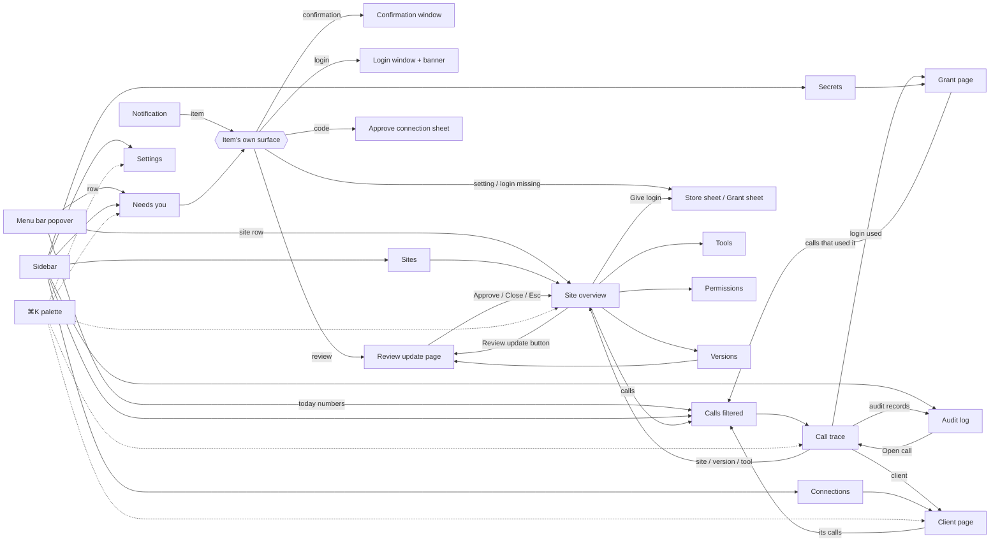

# Valet information architecture

Status: round 2 (after the persona tree tests), 2026-11-11. Owner: the UX thread. The wireframes in
`wireframes/` draw every page and state named here; the design-system thread maps components onto
them. Research behind each choice is in `research/` (interviews, audits, tests). Hypothesis IDs
(E1, P4, ...) are from `research/hypotheses-round1.md`.

Nick was asleep while this was decided, so every choice below is an assumption recorded for his
review, not something he answered. The open questions for him are at the end.

## 1. Decisions from round 1 testing

| Question                     | Decision                                                                                                                                                                                                                                              | Evidence                                                                                                                                                                                                               |
| ---------------------------- | ----------------------------------------------------------------------------------------------------------------------------------------------------------------------------------------------------------------------------------------------------- | ---------------------------------------------------------------------------------------------------------------------------------------------------------------------------------------------------------------------- |
| Top-level navigation         | **IA-A, six places:** Needs you · Sites · Activity · Connections · Secrets · Settings                                                                                                                                                                 | Tree test winners: IA-A for P5, P6, P7; IA-B for P1, P4; IA-C for P2, P3. IA-A was never worse than "unsure" for anyone; IA-C's "Access" made P1, P4, P5, P6 hesitate; IA-B's seven items were too many for P5 and P7. |
| How IA-A answers IA-B's fans | Activity has two **real tabs, each with its own URL and shortcut:** Calls (`⌘3`) and Audit log (`⇧⌘3`). Calls is the first tab.                                                                                                                       | P1 and P4 wanted Calls and the audit log one keystroke away; P5 needs real tabs that change the heading.                                                                                                               |
| How IA-A answers IA-C's fans | The Needs you page, when nothing is waiting, shows **"Nothing needs you"** and the system status (each site's health line, the endpoint, the audit chain with when it was last checked).                                                              | P2 and P3 picked a Home page for that summary; P1, P5, P6, P7 picked a Needs you place they can name. This gives both.                                                                                                 |
| Where the window opens       | **P8a:** on Needs you when something waits, otherwise on Sites; a notification opens the item itself.                                                                                                                                                 | P1, P4, P5, P6, P7.                                                                                                                                                                                                    |
| Status vs action             | **E1:** a badge is never clickable; a real button sits beside it ("Review update").                                                                                                                                                                   | All seven personas, including P1: "I no longer trust any pill to be a link."                                                                                                                                           |
| Labels                       | **Sites** (adapter id and version in the site header; "adapter" kept for Versions and review), **Connections**, **Secrets** (subtitle "Passwords and one-time codes"; search finds "passwords"), **Activity** (tabs Calls, Audit log), **Needs you**. | Sites: 6 of 7 (P4 accepts). Secrets: P1, P3, P4, P6; P2 and P5 accept with the subtitle and search.                                                                                                                    |

## 2. Principles

1. **One inbox.** Every thing that waits for the person is a Needs you item, in the window, the menu
   bar, the notification and the tool result, with the same title in all four. Badges add up to it.
2. **Status is not a button; the button is next to it.** Any state with a next step shows that step
   as a labelled button whose name includes the object ("Review Woolworths update").
3. **Every object is a link, both ways.** Site, version, tool, call, client, secret grant, audit
   record and host each have one URL and one link style. If A shows B, B shows "used by A".
4. **Do the task where you notice it.** Approve from the site page, give a login from the site page,
   pause a site from its health line, open the trolley from the site and the menu bar.
5. **Sheets over context.** Grant, store choice, add a client, approve a connection, revoke dialogs
   open over the page you're on; Escape returns there with focus restored. Only the confirmation
   and the login hand-off get their own windows (safety: they must be answered on the Mac, at once).
6. **One sidebar that never changes shape.** Six places, then the sites list, then a status footer.
7. **State lives in the URL.** Filters, tabs and selection (`#/activity/calls?site=woolworths&outcome=failed`).
   Back and forward work; notifications and tool results can name the exact place.
8. **Every status says when it was checked, and can be re-checked.** ("Audit chain verified 9:41 pm ·
   Check now").
9. **Plain words first.** Technical detail lives under Details, or always shown with the
   "Show technical details" setting (P1).
10. **Kill switches everywhere.** Pause Valet and Lock down in the window toolbar, the menu bar, the
    app menu and on a shortcut.
11. **App, not web page.** Interface text isn't selectable; values are, with a copy button. Arrow
    cursor on controls. Every page has a heading, a window title, and takes focus on its heading.
12. **Nothing is clipped.** Every pane scrolls; every layout has a defined form at 880 x 560 and at
    200% text.

## 3. Site map

```
Menu bar item (badge = Needs you count)
└─ Popover: Needs you (3 rows, + N more) · Sites (one row each) · Today · Pause · Lock down · Open Valet · Quit

Valet window
├─ Needs you                          #/needs-you                ⌘1
│   ├─ Waiting (sorted by deadline)   item → its sheet or its window
│   ├─ Missed (last 24 h)
│   └─ (empty) Nothing needs you + system status
├─ Sites                              #/sites                    ⌘2
│   └─ <Site>                         #/sites/<id>
│       ├─ Overview                   #/sites/<id>              health, store, login, trolley, today, can reach
│       ├─ Tools                      #/sites/<id>/tools        each tool: what it does, side effect, calls, remote on/off
│       ├─ Permissions                #/sites/<id>/permissions  hosts, login pages, request surface, limits
│       ├─ Versions                   #/sites/<id>/versions     pending update, history, compare, restore
│       │   └─ Review update          #/sites/<id>/versions/<hash>/review   full page in the shell
│       │       └─ Code changes       #/sites/<id>/versions/<hash>/review/diff   page with Back to the review
│       └─ Calls                      #/activity/calls?site=<id>   (link, not a copy)
│       sheets: Give Valet your login (grant) · Choose store · Remove site (dialog)
├─ Activity
│   ├─ Calls                          #/activity/calls?site&tool&client&outcome&version&since   ⌘3
│   │   └─ Call                       #/activity/calls/<ref>    trace + inspector (step, request, input/output)
│   └─ Audit log                      #/activity/audit?category&site&call    ⇧⌘3
│       └─ Record                     #/activity/audit/<seq>
├─ Connections                        #/connections              ⌘4
│   ├─ This Mac's endpoint (address, on/off)
│   ├─ Apps on this Mac               → client page #/connections/<clientId>
│   ├─ Cloud agents (remote)          → client page
│   └─ Remote access (on/off, public names)    #/connections/remote
│   sheets: Add an app · Approve a connection (code) · Reset access / Revoke (dialogs)
├─ Secrets                            #/secrets                  ⌘5
│   ├─ Where passwords come from (1Password, Keychain copies)
│   ├─ One-time codes (1Password, Messages)
│   └─ Logins Valet may use (grants)  → grant page #/secrets/<site>/<secret>  (calls that used it)
└─ Settings                           #/settings/<section>       ⌘,  (⌘6)
    ├─ General (open at login, show technical details, text size)
    ├─ Notifications
    ├─ Data and privacy (trace retention, export, audit)
    ├─ Updates
    └─ Reset and uninstall

Own windows: Confirmation (#/confirm/<id>) · Login hand-off (#/needs-user/<site>)
First-run: Setup (#/setup/<step>), re-entrant as a "Finish setup" Needs you item
Overlays: Command palette (⌘K) · Lock down dialog
```

Routes replace today's `#/adapters…`, `#/audit`, `#/clients`, `#/remote`, `#/credentials`. Old
routes redirect, because notifications and tool results already printed may name them.

## 4. Global elements

- **Titlebar (every page):** back/forward, page title, search (`⌘K` palette: pages, sites, calls by
  ref, clients, settings, actions such as "Pause Valet"), Pause Valet / Resume, Lock down (in the
  Pause button's menu).
- **Sidebar:** the six places with alert counts only (Needs you count, red; nothing else carries a
  number); "Sites" list (avatar, name, health dot); footer: one status line (Ready · 2 apps
  connected / Paused / Locked down) that opens Needs you's status block.
- **Menu bar popover (P11):** header (state, Pause), Needs you (3 rows with countdowns, then "+N more"
  to the window), Sites (one row each with its health line, click opens the site), Today (calls,
  failed, blocked, each opens Calls filtered), Open trolley, Open Valet, Quit. Arrow-key navigable;
  focus starts on the first Needs you row. Menu bar icon carries the Needs you count.
- **App menu:** Valet (About, Settings ⌘,, Pause ⇧⌘P, Lock down, Quit), Go (⌘1-⌘5, ⇧⌘3, Back ⌘[,
  Forward ⌘]), Edit (Copy, Find ⌘F), Window, Help.
- **Notifications:** title = the Needs you item title; body = site and deadline as a clock time;
  click opens the item; when an item is missed the notification is replaced by "Missed: …".
- **Toasts:** results of reversible actions, with Undo (Pause, turn off endpoint, turn off a tool).

## 5. Needs you item types

Sorted by deadline (soonest first), then items without a deadline by age. The same title is used by
the app, the menu bar, the notification and the tool result (vocabulary, section 7).

| Kind               | Title                                           | Deadline | Main action                                                                                                                     | Opens                       |
| ------------------ | ----------------------------------------------- | -------- | ------------------------------------------------------------------------------------------------------------------------------- | --------------------------- |
| Confirmation       | Confirm: Remove from cart (Woolworths)          | 2 min    | **Answer** brings the confirmation window forward (never answered inline: the main process accepts Allow only from that window) | Confirmation window         |
| Remote connection  | Approve a connection                            | ~5 min   | **Approve…** opens the code sheet                                                                                               | Code sheet over Needs you   |
| Login hand-off     | Log in to Woolworths (verification check)       | 15 min   | **Show login window**                                                                                                           | Login window + banner       |
| Update review      | Review the Woolworths update (0.4.0)            | none     | **Review update**                                                                                                               | Review page                 |
| First install      | Review Woolworths before first use              | none     | **Review**                                                                                                                      | Review page (summary first) |
| Setting missing    | Choose your Woolworths store                    | none     | **Choose store…**                                                                                                               | Store sheet                 |
| Login missing      | Give Valet your Woolworths login                | none     | **Choose login…**                                                                                                               | Grant sheet                 |
| 1Password locked   | Unlock 1Password                                | none     | **Open 1Password**                                                                                                              | external                    |
| Setup unfinished   | Finish setup (2 steps left)                     | none     | **Continue setup**                                                                                                              | Setup                       |
| Repair ticket      | Woolworths changed: the adapter needs an update | none     | **See what broke**                                                                                                              | the failing call            |
| Audit chain broken | The audit log doesn't check out                 | none     | **See where**                                                                                                                   | Audit log at the break      |
| Missed (any kind)  | Missed: Confirm: Remove from cart (Woolworths)  | 24 h     | **Ask Claude to try again** (copies a sentence) · Dismiss                                                                       | the call                    |

## 6. Object model and link matrix

Objects: **Site** (an installed adapter; versions by content hash), **Tool** (per site), **Call**
(one tool call; short ref like `7F2A`), **Client** (an app on this Mac or a cloud agent), **Secret
grant** (a login a site may use, tied to a version), **Audit record**, **Host**.

| From \ shows   | Site             | Version                          | Tool               | Call                    | Client                   | Grant                       | Audit record         |
| -------------- | ---------------- | -------------------------------- | ------------------ | ----------------------- | ------------------------ | --------------------------- | -------------------- |
| Site page      |                  | Versions tab                     | Tools tab          | Calls (filtered)        | "Called by" on Overview  | Login card                  | via Calls            |
| Call           | site link        | version chip (links to Versions) | tool link          |                         | client link              | "Used login" link           | "Audit records" list |
| Client page    | "Can reach" list |                                  | tools it can call  | its calls               |                          | grants it can cause to fill | its records          |
| Grant page     | site link        | version it's tied to             | tools that fill it | calls that used it      | clients that caused them |                             | records              |
| Audit record   | site             | version                          | tool               | **Open call**           | client                   | grant                       | prev/next            |
| Needs you item | site             | version (reviews)                | tool (confirms)    | the call that raised it | client that called       | grant (missing login)       |                      |

Every client page and site page shows a computed **Can reach** panel (P3's blast radius): which
tools, which hosts, which logins a call from here can cause Valet to fill.

## 7. Shared vocabulary (app and tool results)

Tool results and notifications never carry adapter-supplied text (product names); the confirmation
window can, under "From the site". Tool-result strings are drafted in
`research/tests/round1-P6-agent.md` and must come from one shared table with
`renderer/lib/wording.ts`, tested to match.

| Situation                      | Needs you title / words on screen                           | Tool result says                                                                                                                                                                  |
| ------------------------------ | ----------------------------------------------------------- | --------------------------------------------------------------------------------------------------------------------------------------------------------------------------------- |
| Login hand-off                 | Log in to Woolworths (verification check)                   | Open Valet, Needs you, "Log in to Woolworths (verification check)", open until 10:03 pm                                                                                           |
| One-time code Valet can't read | Log in to Woolworths (one-time code)                        | same pattern                                                                                                                                                                      |
| Irreversible step              | Confirm: Remove from cart (Woolworths)                      | Valet shows it as "Confirm: Remove from cart (Woolworths)" and waits until 9:50 pm                                                                                                |
| Declined / timed out           | Declined / Missed: …                                        | told apart (confirm: declined / confirm: timed-out)                                                                                                                               |
| Remote connection              | Approve a connection                                        | (browser page) Type the code your browser shows into Valet on your Mac                                                                                                            |
| Update waiting                 | Review the Woolworths update (0.4.0)                        | calls keep using the approved 0.3.0; tools it adds wait; Needs you, "Review the Woolworths update (0.4.0)"                                                                        |
| Paused                         | Paused · Resume                                             | Valet is paused, nothing was sent; resume from the menu bar or the Valet window                                                                                                   |
| Locked down                    | Locked down · Unlock                                        | Valet is locked down by the person, so this call was refused and nothing was sent (config: locked-down). The endpoint stays up so agents get this text; cloud agents were removed |
| One site paused                | Woolworths paused · Resume                                  | Woolworths is paused in Valet, so this call was not started and nothing was sent (config: site-paused); ask the person to resume Woolworths in Valet                              |
| Login given up / window closed | (Needs you item ends)                                       | The person closed the login without finishing (needs-user: gave-up); nothing was sent                                                                                             |
| Site limiting                  | Woolworths is limiting requests · calls resume at 9:52 pm   | same, with "Try again in N seconds"                                                                                                                                               |
| Valet's own cap                | Valet is limiting its requests to Woolworths until 10:00 pm | same                                                                                                                                                                              |
| Missing setting                | Choose your Woolworths store                                | same title                                                                                                                                                                        |
| Missing login                  | Give Valet your Woolworths login                            | same title                                                                                                                                                                        |
| Failure                        | Failed · see call 7F2A                                      | The person can see it in Valet, Activity, call 7F2A                                                                                                                               |

Never in the UI: manifest, egress, partition, probe, grant (as a verb shown to P2; "login Valet may
use" instead), client (use "app" or "cloud agent"; "Connections" is the place), MCP outside
Connections and Details.

## 8. Navigation map



## 9. Page inventory (each is drawn in `wireframes/`)

Needs you (waiting, empty with status, missed) · Sites list · Site Overview (ready, needs login,
limited, paused site, first install not approved, update waiting) · Tools · Permissions · Versions ·
Review update (update, first install, dev build quick review) · Grant sheet · Store sheet · Remove site
dialog · Calls (list, filtered, empty) · Call trace (ok, ok with blocked, failed) · Audit log
(intact, broken) · Connections (overview, remote on) · Client page · Add an app sheet · Approve a
connection sheet · Revoke dialog · Secrets · Grant page · Settings (each section) · Lock down dialog ·
Command palette · Confirmation window (arming, ready, expired) · Login hand-off banner · Menu bar
popover (normal, several waiting, paused, first run) · Setup (welcome, 1Password, approve site,
login, store, connect Claude, test it, done) · Window at 880 x 560 and 200% text.

## 10. Assumptions made while drawing

- While an update waits, calls keep using the approved version; tools the update adds wait for it.
- Restore an older version is a review in restore mode (grants are per hash, so it is approved like
  any other version), not a one-click switch.
- Quick review applies to builds whose version ends in `-dev` and widen nothing; several waiting dev
  builds of one site collapse into the newest.
- The Tools tab's cloud-agent switch is the default for new agents; each agent's own choice lives on
  its Connections page and in the Approve a connection sheet.
- A site the person paused is not a Needs you item (it shows in the sidebar dot and the status line).
- Adding a site is out of scope for this redesign (adapters arrive from the authoring agent or a
  file); the Sites list says so.

- Shortcuts: Pause/Resume ⇧⌘P and Lock down ⌥⇧⌘L work while Valet is focused; system-wide
  shortcuts are an opt-in setting, not a default. ⌘O opens Valet from the menu bar popover.
- Unlock (after Lock down) restores sites and the endpoint; removed cloud agents and reset tokens stay
  gone, and the Lock down dialog says so up front.
- A confirmation that runs out while its window is on screen stays open in its Missed state; if the
  Mac was locked, it closes and the Missed item and notification remain.
- Notifications offer Open, plus Decline for confirmations and connections; they never approve.
- Confirmation buttons use the tool's approved title, which is reviewed with the adapter ("Remove from
  cart" / "Don't remove"); product names and other site text appear only in the body under "From the
  site".
- At 200% text the sidebar folds behind a sidebar button (View > Show Sidebar); it is the one
  exception to the sidebar never changing shape.
- Skipping a setup step leaves one "Finish setup (N steps left)" item rather than an item per step.
- Popovers and the confirmation window size to their content (up to 640 and 620 px), so no empty band.

- Calls take a `login=<site>/<secret>` filter, so a login page can link to the calls that used it.
- One login page per site and secret covers every version; versions the login isn't given to yet show
  as "Not given yet" rows.
- Reset access asks first and has no Undo: a token is often reset because it leaked, so the old
  one stops at once (round 2, P3 over P1). Revoke asks first too.
- Apps on this Mac can call every tool (the Can reach panel says so); per-app tool limits for local
  apps are a later feature. Cloud agents choose tools when approved.
- The cloud agent page reuses the app page template.
- 1Password account, CLI path and Messages codes live in Secrets, not Settings; Settings links there.
- Audit categories read "Login use" (secret-use) and "Approvals" (approvals-grants).

## 11. Open questions for Nick (assumed for now)

1. **Six places with Calls and Audit log as tabs** (assumed) or seven with Calls and Audit log both
   top-level. Two personas, including the Nick persona, leaned to seven.
2. **"Sites" in the sidebar** with "adapter" kept for versions and review (assumed), or "Adapters".
3. **Lock down** as a second kill switch beside Pause (assumed, from the security reviewer): pauses
   every site, refuses every call with a "locked down" answer (the endpoint stays up so agents can say why), removes cloud agents, and lists what can't be undone.
4. **A quick review for code-only dev builds** (assumed): when an update adds no host, path, secret or
   irreversible tool, the review is one screen and Return approves; anything that widens access gets
   the full review.
5. **Longer confirmation time** (assumed 2 minutes, with a 5-minute option in Settings, Notifications):
   the away persona wanted time to walk to the Mac; a longer window also means a held tool call waits
   longer.
6. **Calls/Audit log as tabs, Reset access without Undo, Lock down visible in the menu bar** are the
   three choices where personas disagreed; the reasons are in `research/tests/round2-mustfix.md`.
