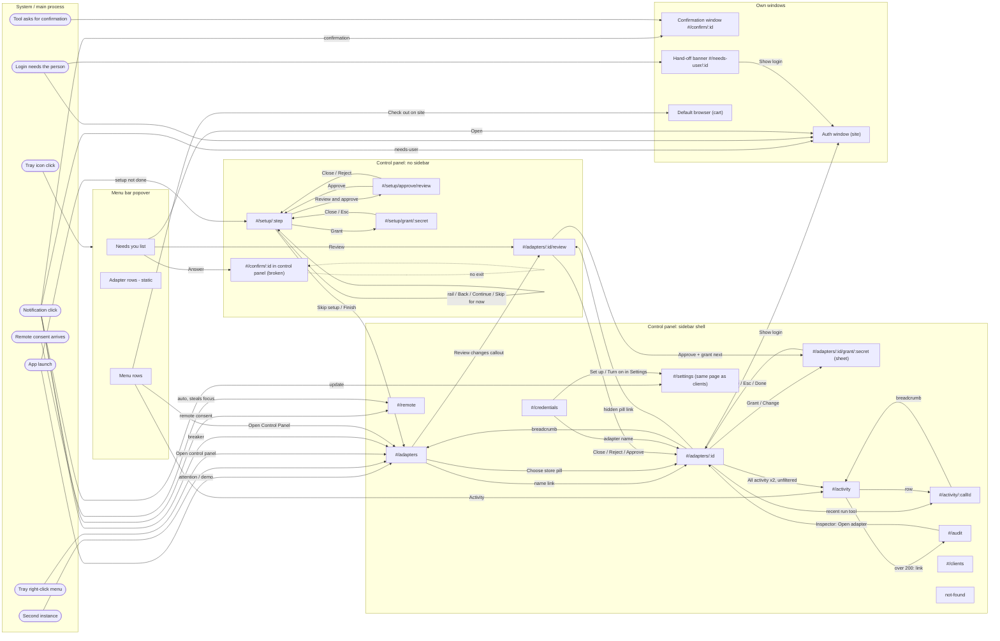

# Navigation and interaction audit (round 1)

Auditor: IA / interaction audit agent. Date: 2026-11-11.
Scope: the current Valet desktop app, read from code (`apps/desktop/src/**`) and the screenshots in
`docs/ux/research/current-screens/`. All `file:line` references are relative to `apps/desktop/src/`.
Nothing in the repo was changed except this file.

## Summary

- **The app has no hub for "what needs me".** The full Needs-you list exists in one place only: the
  menu bar popover (`tray/TrayPopover.tsx:91`). The control panel spreads it across a callout on the
  Adapters page (reviews only), a sidebar badge on Adapters that counts _all_ attention items
  (logins and confirmations included) but leads to a page that lists only reviews, and a separate
  badge on Remote sign-in.
- **Nick's dead end is real, though not quite what he thought.** On the adapter page the way to the
  review is there, but it's hidden: the blue "0.4.0 waiting for review" pill is an `<a>`
  (`renderer/screens/AdapterDetail.tsx:111`) styled exactly like the static pills next to it. No
  hover style, chevron or button shape tells you it's a link. The Adapters table shows the same pill
  ("0.4.0 to review", `screens/Adapters.tsx:185`) and there it really is static. The tray adapter row
  shows it as static text too (`tray/TrayPopover.tsx:292`). "Not approved" is a static pill with no
  Approve action anywhere on the adapter page.
- **The review isn't a page in the shell.** `#/adapters/:id/review` renders full-window with no
  sidebar (`control/App.tsx:28`), so opening it replaces the whole control panel. Its only exit is
  "Close", which always goes to the adapter page, wherever you came from. Escape does nothing there.
- **The tray's "Answer" path for confirmations is broken.** It routes the _control panel_ to
  `#/confirm/:id` (`tray/TrayPopover.tsx:227`). The broker refuses Approve from any window whose
  role isn't `confirmation` (`main/core/confirmations.ts:143`), so Approve fails there. Only Decline
  works. Afterwards the control panel is stuck on a chromeless "You can close this window" screen.
- **Most object references are dead text.** Client names, secret names, hashes, hosts, call IDs in
  the audit table, counts, sparklines, stat tiles, breaker cards, session states and outcome pills
  are almost all presentational. Links between objects mostly run one way (run → trace, grant →
  adapter, audit record → adapter). There is no run → audit, audit → run, client → calls,
  grant → uses, adapter → filtered activity, or tool → its runs.
- **Several core actions live only in the tray**: Pause all adapters, Check out on the site, and the
  complete Needs-you list. Removing an adapter and resetting a breaker exist nowhere.
- **Clients and Settings are one page** (`control/App.tsx:82-85`). The Settings sidebar item only
  swaps the column order (`screens/ClientsSettings.tsx:65`), and the endpoint card sits with Clients.
- **Keyboard and menus are mostly missing.** Valet hides its Dock icon (`main/electron/app.ts:198`),
  sets `LSUIElement`, and never builds an application menu. The tray advertises ⌘, and ⌘1
  (`tray/TrayPopover.tsx:141,148`), but nothing binds them. There's no back/forward, no ⌘F, and
  Escape is handled in only two places (the grant sheet and the confirmation).
- 47 findings below (N01–N47): 7 high-severity dead ends or broken paths, 22 missing object links,
  and the rest one-way paths, orphaned actions and keyboard gaps.

---

## 1. Surfaces and windows

| Surface               | Created by                                                              | Chrome                                  | How it closes                                                                                                                             | Routes it can show                                                                                                  |
| --------------------- | ----------------------------------------------------------------------- | --------------------------------------- | ----------------------------------------------------------------------------------------------------------------------------------------- | ------------------------------------------------------------------------------------------------------------------- |
| Control panel         | `main/electron/windows.ts:67-87` (1180x780, min 880x560, `hiddenInset`) | Traffic lights, sidebar for most routes | Red button / ⌘W (default menu, unverified under LSUIElement)                                                                              | Every route. `review`, `confirm`, `needs-user` and `setup` render **without the sidebar** (`control/App.tsx:28-52`) |
| Menu bar popover      | `windows.ts:89-119`, a click on the tray icon                           | Frameless, transparent                  | Hides on blur (`windows.ts:109`) or a second icon click                                                                                   | `tray.html` only. No routes                                                                                         |
| Tray right-click menu | `main/electron/tray.ts:34-58`                                           | Native menu                             | n/a                                                                                                                                       | Open control panel (last route), Pause/Resume, remote kill switch, Revoke all remote, Quit                          |
| Confirmation panel    | `windows.ts:129-164`, for each pending confirmation                     | Frameless, floating, on all Spaces      | Only by answering. The main process destroys it on settle (`core/confirmations.ts:105`). Escape declines (`screens/Confirmation.tsx:124`) | `#/confirm/:id`                                                                                                     |
| Login hand-off banner | `windows.ts:188-230`, beside the auth window                            | Frameless, always on top                | Destroyed by the main process when the hand-off ends (`core/service.ts:362`). No close control in the UI                                  | `#/needs-user/:adapterId`                                                                                           |
| Auth (login) window   | `core/login.ts` / `openLoginWindow`                                     | Site page                               | "Give up" / "I'm done" on the banner                                                                                                      | Site URLs only                                                                                                      |
| System notifications  | `core/notifications.ts`, `electron/notifications.ts`                    | macOS                                   | Click opens a target                                                                                                                      | See the edges below                                                                                                 |

## 2. Navigation graph

The sidebar reaches every shell page and isn't drawn edge by edge. It links Adapters, Activity,
Audit log, Clients, Remote sign-in, Credentials and Settings. Below those it lists the Sites (each
→ `#/adapters/:id`), or Recent runs (each → `#/activity/:callId`) while in Activity. The footer has
"Run setup again" (→ `#/setup/welcome`). See `control/Sidebar.tsx:86-160`.

## 3. Adjacency table

| #   | From (screen › element)                                       | To                                                             | Trigger                 | Source                                |
| --- | ------------------------------------------------------------- | -------------------------------------------------------------- | ----------------------- | ------------------------------------- |
| E1  | Launch, setup unfinished                                      | `#/setup` (resume)                                             | auto                    | `main/electron/app.ts:424`            |
| E2  | Launch, demo/e2e or attention > 0                             | `#/adapters`                                                   | auto                    | `app.ts:425`                          |
| E3  | Second instance                                               | control panel (last route)                                     | auto                    | `app.ts:395`                          |
| E4  | Tray icon                                                     | popover                                                        | click                   | `electron/tray.ts:33`                 |
| E5  | Tray right-click › Open control panel                         | control panel (last route)                                     | menu                    | `tray.ts:38`                          |
| E6  | Notification: confirmation                                    | confirmation window (focus)                                    | click                   | `app.ts:266`                          |
| E7  | Notification: needs-user                                      | auth window (only if a hand-off is still live)                 | click                   | `app.ts:267-268`                      |
| E8  | Notification: breaker opened                                  | `#/adapters` (not the adapter)                                 | click                   | `core/notifications.ts:124`           |
| E9  | Notification: update downloaded                               | `#/settings` (top, not the Updates card)                       | click                   | `notifications.ts:140`                |
| E10 | Notification: remote consent                                  | `#/remote`                                                     | click                   | `notifications.ts:158`                |
| E11 | Remote consent requested                                      | `#/remote`, opened and **focused**                             | auto                    | `core/service.ts:384`                 |
| E12 | Tool confirmation requested                                   | confirmation window                                            | auto                    | `service.ts:349`                      |
| E13 | Login hand-off                                                | banner and auth window                                         | auto                    | `service.ts:361`                      |
| E14 | Tray › Needs you › Log in › Open                              | auth window                                                    | button                  | `tray/TrayPopover.tsx:204`            |
| E15 | Tray › Needs you › Confirm › Answer                           | control panel `#/confirm/:id` (**Approve fails**)              | button                  | `TrayPopover.tsx:227`                 |
| E16 | Tray › Needs you › Review › Review                            | control panel `#/adapters/:id/review` (no sidebar)             | button                  | `TrayPopover.tsx:252`                 |
| E17 | Tray › Open Control Panel…                                    | control panel, last route                                      | button                  | `TrayPopover.tsx:139`                 |
| E18 | Tray › Activity…                                              | `#/activity`                                                   | button                  | `TrayPopover.tsx:146`                 |
| E19 | Tray › Check out on {site}…                                   | default browser                                                | button                  | `TrayPopover.tsx:130`                 |
| E20 | Sidebar nav (7 items)                                         | each section                                                   | link                    | `control/Sidebar.tsx:86-120`          |
| E21 | Sidebar › Sites › adapter                                     | `#/adapters/:id`                                               | link                    | `Sidebar.tsx:144-153`                 |
| E22 | Sidebar › Recent (Activity only)                              | `#/activity/:callId`                                           | link                    | `Sidebar.tsx:122-140`                 |
| E23 | Sidebar footer › Run setup again                              | `#/setup/welcome`                                              | link                    | `Sidebar.tsx:159`                     |
| E24 | Adapters › review callout › Review changes                    | `#/adapters/:id/review`                                        | button                  | `screens/Adapters.tsx:139`            |
| E25 | Adapters › table › adapter name                               | `#/adapters/:id`                                               | link styled as text     | `Adapters.tsx:161`                    |
| E26 | Adapters › Health › "Choose store" pill                       | `#/adapters/:id`                                               | link styled as pill     | `Adapters.tsx:264`                    |
| E27 | Adapter › breadcrumb "Adapters"                               | `#/adapters`                                                   | link                    | `screens/AdapterDetail.tsx:45`        |
| E28 | Adapter › titlebar "All activity"                             | `#/activity` (unfiltered)                                      | button                  | `AdapterDetail.tsx:52`                |
| E29 | Adapter › hero "x.y.z waiting for review"                     | `#/adapters/:id/review`                                        | **link styled as pill** | `AdapterDetail.tsx:111`               |
| E30 | Adapter › Recent runs › "All activity"                        | `#/activity` (unfiltered)                                      | ghost button            | `AdapterDetail.tsx:187`               |
| E31 | Adapter › Recent runs › tool name                             | `#/activity/:callId`                                           | link                    | `AdapterDetail.tsx:210`               |
| E32 | Adapter › Session › Show login                                | auth window                                                    | button                  | `AdapterDetail.tsx:606`               |
| E33 | Adapter › Secrets › Grant… / Change…                          | `#/adapters/:id/grant/:secret`                                 | button                  | `AdapterDetail.tsx:685,714`           |
| E34 | Adapter › SMS › Grant…                                        | `#/adapters/:id/grant/messages`                                | button                  | `AdapterDetail.tsx:316`               |
| E35 | Grant sheet › Close / Done / Esc                              | `#/adapters/:id`                                               | button, key             | `screens/GrantSheet.tsx:85-107`       |
| E36 | Review › Close                                                | `#/adapters/:id` (always)                                      | button                  | `screens/ReviewUpdate.tsx:153`        |
| E37 | Review › Approve                                              | `#/adapters/:id`, or the grant sheet if "Grant next" is ticked | button                  | `ReviewUpdate.tsx:125-135`            |
| E38 | Review › Reject                                               | `#/adapters/:id`                                               | button                  | `ReviewUpdate.tsx:137-140`            |
| E39 | Activity › row                                                | `#/activity/:callId`                                           | link                    | `screens/Activity.tsx:144`            |
| E40 | Activity › "Older calls are in the Audit log" (over 200 only) | `#/audit` (unfiltered)                                         | inline link             | `Activity.tsx:167`                    |
| E41 | Trace › breadcrumb "Activity"                                 | `#/activity`                                                   | link                    | `Activity.tsx:190`                    |
| E42 | Audit › inspector › Open adapter                              | `#/adapters/:id`                                               | button                  | `screens/AuditLog.tsx:683`            |
| E43 | Credentials › grant › adapter name                            | `#/adapters/:id`                                               | link                    | `screens/Credentials.tsx:119`         |
| E44 | Credentials › provider › Set up / Turn on in Settings         | `#/settings` (top)                                             | button                  | `Credentials.tsx:101`                 |
| E45 | Setup rail steps / Back / Continue / Skip for now             | `#/setup/:step`                                                | link                    | `screens/Setup.tsx:205,242-256`       |
| E46 | Setup › Approve › Review and approve                          | `#/setup/approve/review`                                       | button                  | `Setup.tsx:460`                       |
| E47 | Setup review › Approve / Close                                | `#/setup/grant` / `#/setup/approve`                            | button                  | `control/App.tsx:40`                  |
| E48 | Setup › Grant…                                                | `#/setup/grant/:secret`                                        | button                  | `Setup.tsx:598,629`                   |
| E49 | Setup › "Go to approval"                                      | `#/setup/approve`                                              | link                    | `Setup.tsx:565,662`                   |
| E50 | Setup › Skip setup / Finish                                   | `#/adapters`                                                   | button                  | `Setup.tsx:184-187,221,262`           |
| E51 | Banner › Show login / Give up / I'm done                      | auth window shown / closed / finished                          | button                  | `screens/NeedsUserBanner.tsx:101-119` |
| E52 | Confirmation › Decline / Approve / Esc                        | answers; the window is destroyed                               | button, key             | `Confirmation.tsx:124,258,267`        |

### Reachability per route

| Route                          | In-app ways in                                                                                                             | Notes                                                                                                                                                                       |
| ------------------------------ | -------------------------------------------------------------------------------------------------------------------------- | --------------------------------------------------------------------------------------------------------------------------------------------------------------------------- |
| `#/adapters`                   | sidebar, breadcrumb, setup exit, launch, 2 notifications                                                                   | Fine                                                                                                                                                                        |
| `#/adapters/:id`               | sidebar Sites, Adapters name link (looks like text), "Choose store" pill, Credentials, Audit inspector, review/grant exits | Not reachable from the tray, the trace, the activity list, the breaker card or a notification                                                                               |
| `#/adapters/:id/review`        | Adapters callout, hidden pill on the adapter page, tray Needs you                                                          | **No sidebar.** Not reachable from the Adapters table pill, the tray adapter row, a notification (`notifications.ts:78-80` sends none) or the adapter's "Not approved" pill |
| `#/adapters/:id/grant/:secret` | adapter page Secrets card, review "Grant next"                                                                             | Not from Credentials, the Adapters "not granted" badges, the trace or the banner                                                                                            |
| `#/activity`                   | sidebar, tray menu, two unfiltered "All activity" buttons                                                                  | No filtered entry (by adapter, client, tool, outcome or today)                                                                                                              |
| `#/activity/:callId`           | Activity rows, sidebar Recent, adapter Recent runs                                                                         | **Not from the Audit log** (Call column is plain text), the tray, a notification or a confirmation                                                                          |
| `#/audit`                      | sidebar, Activity's over-200 footnote                                                                                      | No deep link with a filter (filters are local state, `AuditLog.tsx:63-68`)                                                                                                  |
| `#/clients`                    | sidebar only                                                                                                               | Only one way in                                                                                                                                                             |
| `#/settings`                   | sidebar, Credentials provider buttons, update notification                                                                 | Same page as Clients                                                                                                                                                        |
| `#/remote`                     | sidebar, notification, auto-open on a consent request                                                                      | Remote clients aren't linked from Clients                                                                                                                                   |
| `#/credentials`                | sidebar only                                                                                                               | Only one way in. The Adapters-page Credentials card doesn't link here                                                                                                       |
| `#/confirm/:id`                | own window (correct); tray Answer into the control panel (broken)                                                          |                                                                                                                                                                             |
| `#/needs-user/:id`             | own window only                                                                                                            |                                                                                                                                                                             |
| `#/setup/*`                    | first launch, sidebar footer "Run setup again"                                                                             | No way to cancel back to where you were                                                                                                                                     |

---

## 4. Findings

Severity: **H** = dead end, broken path or task blocker. **M** = expected path missing, or one-way
only. **L** = polish and consistency.

### A. Dead ends, broken and one-way paths

**N01 · H · The adapter page's review link is a pill nobody reads as a link.**
Screen: Adapter detail › hero. Element: "0.4.0 waiting for review" (`AdapterDetail.tsx:110-114`).
It's an `<a class="pill info">`, and `a.pill` has no hover, underline, chevron or cursor style
(`styles/app.css:547-580`, `tokens.css:139` `cursor: default`). Static pills ("Approved", "Not
approved") sit next to it, so it reads as a status. This is Nick's dead end.
Expect: a prominent "Review update" button (or a callout like the one on the Adapters page) at the
top of the adapter page, plus a matching notice in the Tools/Permissions area.

**N02 · H · "Not approved" offers no way to approve.**
Screen: Adapter detail hero (`AdapterDetail.tsx:107-109`) and the Adapters table
(`Adapters.tsx:182`). A first-install adapter shows a grey "Not approved" pill. The only way
forward is the hidden pill from N01.
Expect: "Review and approve…" as the primary action wherever "Not approved" appears.

**N03 · H · Tray "Answer" for a confirmation opens a screen where Approve can't work.**
Screen: Tray › Needs you › Confirm › Answer (`TrayPopover.tsx:223-230`). It calls
`openControlPanel('#/confirm/:id')`, which renders the confirmation inside the control panel window
(`App.tsx:30-31`). The broker accepts Approve only from the `confirmation` window that shows that ID
(`main/core/confirmations.ts:143`), so Approve throws `ConfirmationRefused` and the person sees
"Couldn't…". After a decline, the panel says "You can close this window" (`Confirmation.tsx:66`) in
a control panel that has no sidebar and no way back.
Expect: Answer focuses the existing confirmation window (`windows.focusConfirmation` already exists,
`windows.ts:170`, but the renderer API doesn't expose it).

**N04 · H · Review takes over the whole control panel, with one fixed exit.**
Screen: `#/adapters/:id/review` renders without the sidebar (`App.tsx:28-29`, `ReviewUpdate.tsx:150`).
Close always goes to the adapter page (`ReviewUpdate.tsx:76,153`), even when you came from the
Adapters callout or the tray. Escape doesn't close it. There's no breadcrumb and no back.
Expect: a modal sheet over the page you came from (like the grant sheet), or a shell page with a
breadcrumb. Close and Escape return to where you were.

**N05 · H · There's no Needs-you inbox in the control panel.**
The complete attention list (logins, confirmations, reviews, plus remote consents and choices still
needed) appears only in the tray (`TrayPopover.tsx:91-101`). The control panel's "Needs you" filter
on Adapters (`Adapters.tsx:58-66`) filters adapters, not tasks, and can't show confirmations or
consents.
Expect: a top-level "Needs you" or Home destination listing every item with its action. The
sidebar badge belongs there.

**N06 · H · The Adapters badge counts items the Adapters page doesn't show.**
Sidebar › Adapters badge = `attention.length` (`Sidebar.tsx:73,91`), which includes login
hand-offs and confirmations. In `adapters.png` the badge says 3 but the page shows one callout.
Clicking the badge can't explain the number.
Expect: the badge counts what the destination lists. Move the total to the Needs-you hub (N05).

**N07 · H · An update arriving while Valet runs gets no notification.**
`attentionNotification` returns null for `review` because "the control panel opens on it anyway"
(`core/notifications.ts:78-80`). That only happens at launch (`app.ts:425`), and even then it opens
`#/adapters`, not the review. A bundle from the IDE or authoring agent mid-session shows up only as a
tray row and a sidebar badge.
Expect: a notification ("Woolworths 0.4.0 is ready for review") that opens the review.

**N08 · M · The breaker notification lands on the list, not the site.**
`breakerOpened` targets `#/adapters` (`notifications.ts:124`).
Expect: the affected adapter page, Session/Site health section (or a site health view), with
"what this means" and the next steps.

**N09 · M · The update notification lands on the top of Settings, not Updates.**
It targets `#/settings` (`notifications.ts:140`). The Updates card sits below the Settings card
(`ClientsSettings.tsx:216-219`), off-screen at 780 px (`settings.png`).
Expect: `#/settings/updates`, or a route that scrolls to and highlights the card.

**N10 · M · A remote consent request takes focus from whatever you're doing.**
`consentRequested` calls `openControlPanel('#/remote')` (`service.ts:384`), which `show()`s and
`focus()`es (`windows.ts:71-72`). Anyone who can reach the public address can trigger it. That's
also a nuisance and spoofing vector.
Expect: the notification plus a badge, with no automatic focus, or open without activating the window.

**N11 · M · Setup has no Cancel when you re-run it.**
"Run setup again" (`Sidebar.tsx:159`) drops you into the full-window setup at Welcome. The only exits
are "Skip setup" or "Finish", and both call `api.setup.finish()` and go to `#/adapters`
(`Setup.tsx:184-187`), not back where you were. The setup steps are hard-wired to Woolworths
(`SETUP_ADAPTER`, `App.tsx:39`).
Expect: "Back to Valet" that returns to the previous route. Setup as a re-entrant checklist
("Getting started") rather than a mode.

**N12 · M · The setup steps' tasks can't be found later as their own entry points.**
Setup's "Approve", "Grant", "Store", "Clients" and "1Password" steps match control panel features in
four different sections. Nothing in the control panel uses the same names or ordering, so someone
who skipped a step can't find "the store step" again (cards 4, 5, 26).
Expect: per-adapter readiness ("Approve ✓ · Sign-in ✓ · Store ✗") on the adapter page, using
setup's words.

**N13 · M · The hand-off banner's empty state has no way to close it.**
`#/needs-user/:id` shows "Nothing is waiting for you here" (`NeedsUserBanner.tsx:20-26`) in a
frameless, always-on-top window (`windows.ts:205-218`) with no Close button. It relies on the main
process destroying it.
Expect: a Close/dismiss control in every state of every frameless window.

**N14 · M · Pause all adapters is only in the tray.**
`setPaused` is called only from `TrayPopover.tsx:154` and the tray right-click menu (`tray.ts:40`).
The control panel shows no paused state and has no resume, apart from the sidebar's "MCP on" dot.
Expect: a global status and pause control in the control panel header or sidebar footer, plus a
per-adapter pause.

**N15 · M · "Check out on {site}" is only in the tray.**
`openCart` is called only from `TrayPopover.tsx:130` (card 10).
Expect: an "Open trolley on woolworths.com.au" action on the adapter page header.

**N16 · M · Removing or uninstalling an adapter is possible nowhere.**
There's no API or UI for it (card 34). A rejected adapter shows "Rejected" (`Adapters.tsx:180`)
with no way to re-review or remove it.
Expect: an adapter overflow menu with Remove, and Review again for a rejected one.

**N17 · M · You can't act on a breaker.**
The breaker card (`Adapters.tsx:280-325`), the adapter Session card (`AdapterDetail.tsx:624-635`)
and the tray ("Blocked by site · retry in 4 min") all just report. There's no "Try now", no "Pause
this site" and no link to the blocked requests that caused it (card 25, scenario S7).
Expect: the site health view lists the cause, the triggering run (→ trace), the audit records
(→ filtered audit) and a manual "Try again now", or at least "Why?".

**N18 · M · Clients and Settings share a page.**
`#/clients` and `#/settings` both render `ClientsSettingsPage` (`App.tsx:82-85`). Settings only
reorders the columns (`ClientsSettings.tsx:65`, a `settings-first` class). The title is "Clients and
settings" for both. The MCP endpoint (cards 22, 23) lives in the Clients column.
Expect: separate pages. Endpoint and Clients under "Connections". Settings split into General,
Credentials sources, Updates, and Reset.

**N19 · M · Remote clients and local clients live in different places with no cross-link.**
Remote clients are on `#/remote` (`RemoteConsent.tsx:236-310`). Local clients are on `#/clients`.
Neither mentions the other. Scenario S6 ("token leaked, cut it off") means checking both.
Expect: one Clients page with Local and Remote groups, or links each way.

**N20 · M · Turning a tool on for remote use can only happen on the Remote page.**
The per-tool remote switch (`RemoteConsent.tsx:445-460`) has no counterpart on the adapter page's
Tools table (`AdapterDetail.tsx:157-177`), which is where card 21 would be looked for.
Expect: a "Remote" column or toggle per tool on the adapter page, linked to the Remote page.

### B. Missing object-to-object links

**N21 · M · A run's trace doesn't link to its adapter.**
Trace header: the avatar (`Activity.tsx:232`) and the "Adapter 0.3.0 <hash>" KPI
(`Activity.tsx:250-255`) are static. The breadcrumb is Activity › `woolworths.update_cart_line`,
and the adapter part isn't a link.
Expect: avatar and name → `#/adapters/:id`. If the version hash isn't the current approved one,
mark it ("older version").

**N22 · M · A run's trace doesn't link to its client.**
The "Client" KPI is `<ClientName>` (`Activity.tsx:241-245`, `components/ui.tsx:107-118`), which is
quoted text with a tooltip.
Expect: the registered client → its client page or a filtered activity view. The reported name
stays shown as a claim.

**N23 · M · A run's trace doesn't link to the secrets it used.**
"Secrets used: login (2 fields)" (`Activity.tsx:268-275`) and the `secret:login.username` chips in
`fill(...)` steps (`Activity.tsx:444-449`) are text.
Expect: → the grant (adapter page Secrets card, or a Credentials row anchored to it).

**N24 · H · A run's trace doesn't link to its audit records, and vice versa.**
There's no "Show in audit log" on the trace. The Audit log's **Call** column prints the call ID as
plain mono text (`AuditLog.tsx:300-302`), and the inspector has "Open adapter" but no "Open call"
(`AuditLog.tsx:681-686`). Audit filters live in component state (`AuditLog.tsx:63-68`), so you
can't link to "audit for c_8f2e1b".
Expect: two-way links. Call ID → `#/activity/:callId`. Trace → `#/audit?call=:callId`. Audit
filters go in the URL.

**N25 · M · Blocked-request callouts on the trace lead nowhere.**
Each blocked request (`Activity.tsx:292-315`) explains itself but doesn't link to the manifest
permission it broke (adapter Permissions card), the matching `request-blocked` audit record, or
the site's breaker.
Expect: "See allowlist" → adapter Permissions (host highlighted). "Audit record" → the audit
record. Card 13 (see which requests were blocked) needs a cross-run "Blocked" view: the tray tile
and the Today card count them but don't link to them.

**N26 · M · Trace steps for confirmations and needs-you can't be acted on.**
The "You declined the confirmation" step (`Activity.tsx:532-547`) doesn't link to the confirmation
record. The "Needs you: verification check" step (`Activity.tsx:549-559`) offers no "Show login"
even while that hand-off is still open.
Expect: a live action when the item is still pending, and a link to its audit record otherwise.

**N27 · M · You can't get from a client to its calls.**
Clients table rows (`ClientsSettings.tsx:311-357`): the name, "Last call 1 min ago" and "Calls · 7d
141" are all static. The Activity client filter is keyed on the _reported_ name
(`Activity.tsx:113,128-131`), the Audit filter on the registered client ID (`AuditLog.tsx:226-233`).
Neither can be reached from the client row.
Expect: a client detail page (or row expansion) with recent calls, last seen, tokens, Reset and
Revoke, and links to `#/activity?client=…` and `#/audit?client=…`. Pick one client identity for
both filters.

**N28 · M · You can't get from a grant to the calls that used it.**
Credentials › "Last used 9:47 pm" (`Credentials.tsx:130`) and the adapter page's grant block
(`AdapterDetail.tsx:693-712`) are text.
Expect: Last used → the run that used it. A "Uses" link → audit filtered to `secret-used` for that
adapter and secret.

**N29 · M · Credentials lists only granted secrets, so you can't grant from there.**
Ungranted requests (Coles "SMS code · not granted") aren't rows. The empty state says "Grant a
secret from an adapter's page" as plain text (`Credentials.tsx:33`).
Expect: rows for requested-but-ungranted secrets with "Grant…" opening the grant sheet. Every
adapter mention should link.

**N30 · M · The audit record inspector only links one object.**
The inspector (`AuditLog.tsx:606-700`) offers "Open adapter". It has nothing for the call, client,
secret/grant, version (for `adapter-approved`) or host (for breaker events). The chain blocks for
the previous and next record (`AuditLog.tsx:655-679`) look like cards but aren't clickable.
Expect: an action for each entity in the record. Chain blocks select that record. "Chain broken at
record N" (`AuditLog.tsx:343-353`) jumps to N.

**N31 · M · Activity can't be filtered by adapter, though the API supports it.**
`runs.list` takes `adapterId` (`shared/api.ts:908`). The Activity page offers only outcome and
client (`Activity.tsx:119-133`). Both "All activity" buttons on the adapter page
(`AdapterDetail.tsx:52,187`) drop you on the unfiltered list.
Expect: `#/activity?adapter=woolworths` (also tool and period), with the adapter page's buttons
pre-filtered and labelled "All Woolworths runs".

**N32 · L · Remote clients don't link to their calls or to remote-consent audit records.**
The remote client host and tool list (`RemoteConsent.tsx:283-290`) are text.
Expect: host → that client's calls. Tools → the tools.

### C. Presentational elements that should be interactive

Each row gives what a person expects a click to do.

**N33 · M · The Adapters table is mostly inert** (`Adapters.tsx:146-278`, `adapters.png`).

- Row: only the name is a link, styled `color: inherit` (`:161`). Expect the whole row (and avatar) to open the adapter.
- "0.4.0 to review" pill (`:184-186`): expect → review. The adapter page's equivalent pill _is_ a link, so they're inconsistent.
- "Not approved" / "Rejected" (`:179-182`): expect → review, or "Review again".
- "3 read / 3 write" tool counts (`:190-200`): expect → adapter Tools.
- "login · not granted" and "SMS code · not granted" badges (`:207-220`): expect → grant sheet for that secret.
- "Login window open" session state with its pulsing dot (`:225-246`): expect "Show login".
- Health "Needs you" (`:258-259`): expect → the specific action. "Blocked by site · Retry in 4 min" (`:249-257`): expect → site health. "Choose store" _is_ a link (`:264`), which makes the column inconsistent.
- Calls · 7d (`:275`): expect → Activity filtered to this adapter.
- Version hash (`:170`, `Hash` in `components/ui.tsx:98-104`): expect click to copy, with a tooltip.

**N34 · M · The Adapters page's lower cards are inert** (`Adapters.tsx:280-387`).

- Site circuit breakers: host and avatar → adapter or site health. "Open · 3:58" → why, plus Try now.
- Today card: "Tool calls 37" → Activity (today). "Logins 3 · 0 failed" → Audit filtered to Logins. "Blocked requests 12" → Audit filtered to Blocked. Sparkline bars → that hour.
- Credentials card: each provider row → Credentials (provider section). "· not set up" → the relevant setting. The card head → `#/credentials`.

**N35 · M · The adapter page is inert beyond its links** (`AdapterDetail.tsx`, `adapter-wow.png`).

- Tools table rows (`:157-178`): expect → tool detail (its runs, remote availability, confirmation policy). Calls · 7d (`:176`) → filtered activity.
- Recent runs › Client (`:213`) → client. Outcome pill "needs you" (`:216`) → the action, or the trace. "2 blocked" (`:217-219`) → trace › Requests view.
- Permissions host and origin chips (`:238-257`): expect → requests to that host (audit), or copy.
- Session pill "Waiting for you" (`:593-599`): expect the same action as "Show login".
- Session "Site" row (`:621-636`): expect → breaker detail.
- Secrets › "Granted" pill (`:682-683`), "Bound to 1Password 'Woolworths'" (`:696-698`), "Valid for <hash>" (`:708-711`): expect Change, open in 1Password if possible, and an explanation of the version tie with a link.
- Content hash (`:128-133`): expect copy.
- Settings › "Chosen" pill (`:395-396`): fine. "Waiting for you" (`:337-338`) → scroll to the field.

**N36 · M · The tray popover is mostly inert** (`TrayPopover.tsx`, `tray-full.png`).

- Header status "Running · 2 clients connected" (`:44-51`): expect → Clients.
- Endpoint URL row (`:55-69`): only the copy icon works. Expect the whole row to copy.
- Stat tiles "37 Tool calls today", "3 Logins", "12 Blocked requests" (`:71-89`): they look like cards (`tray.png`). Expect → Activity (today), Audit Logins, Audit Blocked.
- "Needs you 3" count pill (`:95`): expect → Needs-you hub (N05).
- Adapter rows (`:260-303`): avatar, name, state. Expect → adapter page. "0.4.0 waiting for review" (`:292-297`) → review. "Login window open" → Show login. "Blocked by site · retry in 4 min" → site health.
- Attention row bodies (`:184-198`, `:217-222`, `:239-246`): only the button acts. Expect the whole row to act.

**N37 · M · The sidebar footer is inert** (`Sidebar.tsx:158-189`).
"MCP on · 127.0.0.1:47821" looks like a status link (`:163-170`). Expect → endpoint settings, or copy.
"Audit chain intact" / "broken" (`:171-188`): expect → Audit log, and a broken chain should be an
alert link. "Run setup again" sits in link blue next to them while the other two are grey, so
the one rarely-wanted action gets the strongest styling.

**N38 · L · Audit table rows can be selected only through the tiny Seq button.**
The row `tr` has no click handler (`AuditLog.tsx:272-304`), so the only target is the Seq number
(`:283-291`, a `btn ghost` stripped of styling). The selected-row highlight suggests rows are
clickable. The Hash column (`:303`) isn't copyable. The event-type chip (`:295-297`) doesn't filter.
Expect: the whole row selects, ↑/↓ moves the selection, the event chip filters to that type, and
hash copies.

**N39 · L · Activity list rows are a single link, so inner objects can't be targeted.**
`activity-row` is one `<a>` (`Activity.tsx:144-159`). The adapter name and client inside can't link.
Expect: row → trace, with secondary hover actions (adapter, client), or a table with linked cells.

**N40 · L · Clients table rows put three actions in a column, and Revoke doesn't ask.**
"Set up / Reset access / Revoke" stack vertically (`settings.png`). Revoke (`ClientsSettings.tsx:349-357`)
and grant Revoke (`Credentials.tsx:144-150`, `AdapterDetail.tsx:717-724`) fire immediately with no
confirmation and no undo. "Revoke all remote clients" does ask (`RemoteConsent.tsx:244-260`).
Expect: an overflow menu per row. Destructive actions confirm or offer Undo. The client name opens
client detail (N27).

**N41 · L · Hashes everywhere are titles only.**
`Hash` (`components/ui.tsx:98-104`) shows a tooltip. It doesn't copy and doesn't explain itself. It's
used on Adapters, Adapter, Review, Trace, Credentials and Audit.
Expect: one Hash component with click-to-copy, "copied" feedback, and a popover saying "this is the
content hash of version 0.3.0", with a link to that version.

**N42 · L · Text in settings and remote screens names a place without linking to it.**

- "Approve one on the Adapters page first." (`RemoteConsent.tsx:441`)
- "Messages codes are off in Settings." in the grant sheet (`GrantSheet.tsx:369`)
- "Pausing remote access from the menu bar…" (`RemoteConsent.tsx:307-308`)
- "Grant a secret from an adapter's page." (`Credentials.tsx:33`)
- "Turn on automatic installs in Settings" (notification body, `notifications.ts:139`)
  Expect: each place name is a link, or a button that does the thing in place.

**N43 · L · Credentials buttons go to a page, not to the setting.**
"Set up in Settings" / "Turn on in Settings" (`Credentials.tsx:93-99`) go to `#/settings` with no
anchor, so you have to find the 1Password, Messages or Keychain row yourself.
Expect: deep anchors (`#/settings/credentials/messages`), or set the provider up right there.

### D. Shell, keyboard and menus

**N44 · M · The shortcuts shown in the tray aren't wired up.**
The tray shows ⌘, (Open Control Panel), ⌘1 (Activity) and ⌘Q (`TrayPopover.tsx:141,148,170`). No
handler, global shortcut or application menu exists: `Menu` is used only for the tray context menu
(`electron/tray.ts:37`). The Dock icon is hidden and `LSUIElement` is set (`app.ts:198`,
`electron-builder.config.ts:471`). ⌘Q (and ⌘W, ⌘C/⌘V) depend on Electron's default menu, which may
or may not dispatch while the app is an agent. _Unverified at runtime._
Expect: a real application menu while the control panel is key (File, Edit, View with ⌘1…⌘7 for the
sections, Window), with the advertised shortcuts bound. Or don't show them.

**N45 · M · There's no back or forward.**
Navigation is hash-based (`lib/router.ts:10-17`), so history entries exist, but nothing exposes
them: no toolbar back button, no ⌘[ / ⌘], no swipe. Breadcrumbs exist only on the adapter page and
trace (`AdapterDetail.tsx:44-50`, `Activity.tsx:189-195`). The review and setup routes have neither.
Expect: back/forward in the titlebar and on the keyboard, and breadcrumbs on every second-level page.

**N46 · L · Escape and focus behave differently from screen to screen.**
Escape closes the grant sheet (`GrantSheet.tsx:104`) and declines the confirmation
(`Confirmation.tsx:124`). It does nothing in the review, setup or setup-review, and nothing in the
inline "Add a client" or Change-store forms. No search field has ⌘F (Adapters, Audit). Filter
state isn't kept in the URL or between visits (Adapters filter `Adapters.tsx:36-37`, Activity
`Activity.tsx:100-101`, Audit `AuditLog.tsx:63-68`).
Expect: Escape closes the topmost transient surface everywhere, ⌘F focuses page search, and filters
persist in the URL.

**N47 · L · The sidebar changes shape between sections, and its counts mean different things.**
In Activity the "Sites" list is replaced by "Recent" runs (`Sidebar.tsx:122-157`), so the adapter
shortcuts disappear exactly when you're looking at a run you might want to trace back to its
adapter. The counts aren't comparable: Adapters = attention items (alert orange), Activity = tool
calls today (grey, but the page shows the last 200, not today), Clients = active clients (grey),
Remote = pending consents (orange). The "Adapters" item isn't highlighted while an adapter is
selected (`Sidebar.tsx:90`), so the selection jumps to the Sites list.
Expect: a stable sidebar. Badges only for "needs you" counts. Section highlight stays on while
you're in a child page.

---

## 5. The open card sort, mapped to where things are today

| Card                   | Where it is now                                                      | Problem                                                   |
| ---------------------- | -------------------------------------------------------------------- | --------------------------------------------------------- |
| 1 Approve update       | Adapters callout; hidden pill on the adapter page; tray              | N01, N02, N04, N07                                        |
| 2 Hosts/paths          | Adapter › Permissions                                                | Chips inert (N35)                                         |
| 3 Tools                | Adapter › Tools                                                      | No tool detail (N35)                                      |
| 4 Store                | Adapter › Settings card; Setup › Store                               | OK. Adapters "Choose store" pill is the only health link  |
| 5 Give a password      | Adapter › Secrets › Grant…; Setup                                    | Not from Credentials or the Adapters badges (N29, N33)    |
| 6 Revoke grant         | Adapter › Secrets; Credentials                                       | Revoke doesn't ask (N40)                                  |
| 7 Re-sync Keychain     | Credentials only                                                     | Not on the adapter page                                   |
| 8 Log in when asked    | Banner/auth window; tray; notification; adapter Session › Show login | Adapters "Needs you" inert (N33)                          |
| 9 Confirm              | Own window; notification; tray (broken)                              | N03                                                       |
| 10 Open trolley        | Tray only                                                            | N15                                                       |
| 11 Today's calls       | Tray tiles; Adapters Today card; Activity (not filterable by day)    | N34, N36                                                  |
| 12 Why a call failed   | Activity › trace                                                     | No link from the adapter outcome pill or audit (N24, N35) |
| 13 Blocked requests    | Trace; Audit › Blocked chip                                          | Counts inert (N25, N34)                                   |
| 14 Verify chain        | Audit                                                                | Footer status not a link (N37)                            |
| 15 Export audit        | Audit                                                                | OK                                                        |
| 16 Add Claude Desktop  | Clients › Add a client › Set up › Add to Claude Desktop; Setup       | Three steps deep on a mixed page (N18)                    |
| 17 Reset client        | Clients                                                              | OK                                                        |
| 18 Revoke client       | Clients; remote clients on Remote                                    | N19, N40                                                  |
| 19 Turn on remote      | Remote page; tray right-click                                        | OK                                                        |
| 20 Approve remote code | Remote page (auto-opens)                                             | N10                                                       |
| 21 Remote tool on/off  | Remote page only                                                     | N20                                                       |
| 22 MCP address         | Tray; Clients page; sidebar footer                                   | Footer inert (N37)                                        |
| 23 MCP off             | Tray menu; Clients page switch                                       | Under "Clients" (N18)                                     |
| 24 Pause all adapters  | Tray only                                                            | N14                                                       |
| 25 Breaker             | Adapters card; adapter Session; tray                                 | No action (N17)                                           |
| 26 Set up 1Password    | Settings rows; Setup; Credentials buttons                            | Split across three places (N43)                           |
| 27 SMS codes           | Settings                                                             | Grant sheet text not linked (N42)                         |
| 28 Trace retention     | Settings                                                             | OK                                                        |
| 29 App updates         | Settings › Updates                                                   | Notification lands above it (N09)                         |
| 30 Run setup again     | Sidebar footer                                                       | No Cancel (N11)                                           |
| 31 Reset/uninstall     | Settings › bottom                                                    | OK                                                        |
| 32 Open at login       | Settings                                                             | OK                                                        |
| 33 Notifications       | Settings                                                             | OK                                                        |
| 34 Remove an adapter   | Nowhere                                                              | N16                                                       |
| 35 What needs me       | Tray only                                                            | N05                                                       |

---

## 6. IA principles the redesign should adopt

1. **One inbox.** A top-level _Needs you_ destination (also the control panel's default landing
   page when anything is waiting) lists every pending item: reviews, logins, confirmations, remote
   consents, required choices and broken chains. The tray mirrors it, and every badge in the app
   adds up to it.
2. **Every object is a link, everywhere it appears.** Adapter, version/hash, tool, run, client
   (local or remote), secret/grant, host/site, audit record and setting each have a canonical URL.
   One component per object type (`<AdapterLink>`, `<RunLink>`, `<ClientLink>`, `<HashChip>`)
   renders a mention with the same affordance and hover card.
3. **Status is actionable.** If a pill says something needs doing ("waiting for review", "not
   granted", "Needs you", "Blocked by site", "Login window open"), it _is_ the button for that
   action, styled as a button or with a chevron. Pure status uses a different visual form, so a
   pill that does nothing never looks like one that does.
4. **Links run both ways.** Run ↔ audit records, client ↔ calls, grant ↔ uses, adapter ↔ runs,
   tool ↔ runs, breaker ↔ blocked requests. If A shows B, B can show "used by A".
5. **Do the task where you notice it.** Approve from the adapter page, grant from Credentials or the
   Adapters table, show login from any "Needs you" state, open the trolley from the adapter. Remove
   single-location actions (tray-only Pause and Checkout).
6. **Transient surfaces are sheets over their context.** Review, grant, confirm and add-client open
   as modal sheets over the page that launched them. Escape or Close returns there, and the shell
   stays visible. Only safety-critical prompts (the confirmation, the login hand-off) get their own
   windows, and those focus the existing window instead of re-rendering in the control panel.
7. **Filters and selection live in the URL.** `#/activity?adapter=…&client=…&outcome=…&since=today`,
   `#/audit?call=…&category=…`, `#/settings/updates`. Cross-links can then land on a filtered
   view, notifications can deep-link to the exact item, and back/forward work.
8. **One page per noun, one sidebar that doesn't change shape.** Sites/Adapters, Activity, Audit,
   Connections (endpoint, local and remote clients), Credentials, Settings (split into
   sub-sections). The sidebar shows the same items in every section, and a badge means "needs you".
9. **Notifications deep-link to the item, never to a list, and never steal focus.** That includes
   adapter reviews arriving mid-session.
10. **A real Mac shell.** An application menu while the control panel is key, ⌘1…⌘n for sections,
    ⌘, for Settings, ⌘[ and ⌘] for back and forward, ⌘F for search, Escape for the topmost
    surface. Only advertise shortcuts that are bound. Also: non-selectable UI chrome, a pointer or
    hover state on every interactive element, and selectable text only for values people copy
    (hashes, URLs, IDs, JSON).
11. **Setup is a re-entrant checklist, not a mode.** "Getting started" stays reachable, shows the
    readiness of each adapter, and its steps open the same pages and sheets the control panel uses.
    Leaving it returns you to where you were.
12. **Destructive actions confirm or offer Undo, consistently.** Revoke grant, Revoke client,
    Remove host, Reject update.
